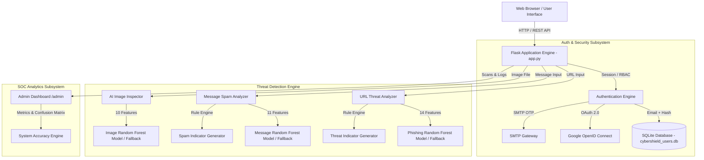

# CyberShield AI - Comprehensive Technical Documentation

## Executive Summary

**CyberShield AI** is an enterprise-grade, multi-vector threat detection and security analytics platform. Designed to protect users and organizations against digital fraud, cyber threats, and identity manipulation, CyberShield AI combines advanced heuristic feature extraction with trained Machine Learning classifiers (Random Forest) to evaluate threats in real time across three primary attack vectors:

1. **Phishing URL Detection**: Analyzes web addresses for brand spoofing, suspicious domain structures, hidden IP addresses, and credential harvesting patterns.
2. **Fake & Scam Message Analysis**: Inspects SMS, email, and social media message text for coercive language, spam keywords, financial scam triggers, and link hijacking.
3. **AI-Generated / Deepfake Image Detection**: Examines uploaded image files for synthetic generation markers, EXIF metadata anomalies, noise distribution patterns, and edge frequency artifacts.

The platform includes a modern web interface with a SOC (Security Operations Center) dashboard, role-based access control (RBAC), dual-method authentication (Email/Password & Google OAuth 2.0), OTP password recovery via SMTP, and serverless-resilient fallback architectures.

---

## 1. System Architecture

CyberShield AI is built as a Flask WSGI application using a modular layer pattern separating the web frontend, authentication engine, threat classification engine, and administrative analytics subsystem.



### Technology Stack

| Layer | Technology / Library | Purpose |
| :--- | :--- | :--- |
| **Backend Web Framework** | Python 3.x, Flask 3.x | Web routing, session handling, API endpoints |
| **Database & ORM** | SQLite 3, Flask-SQLAlchemy | User credentials, roles, profile storage |
| **Machine Learning** | scikit-learn, joblib | Random Forest model training & inference |
| **Data Processing** | NumPy, pandas | Matrix transformation & feature engineering |
| **Image Analytics** | Pillow (PIL), OpenCV | Image metadata & pixel histogram analysis |
| **Authentication** | Werkzeug (PBKDF2/Bcrypt), `google-auth` | Password hashing & OAuth 2.0 authentication |
| **Email Gateway** | Python `smtplib`, `email.mime` | OTP password recovery email delivery |
| **Frontend UI** | HTML5, Vanilla CSS3, JavaScript (ES6+) | Dashboard, real-time charts, tabbed interface |
| **Serverless Ready** | `vercel.json`, `/tmp` fallback storage | Zero-config deployment on Vercel platform |

---

## 2. Machine Learning Engine & Feature Engineering

CyberShield AI leverages custom feature extraction pipelines paired with Random Forest Classifiers trained on domain-specific security datasets.

### 2.1 Phishing URL Detection Module

* **Primary Script**: [feature_extraction.py](file:///c:/Users/AJITH%20KUMAR/Desktop/cybershild-ai-main/feature_extraction.py#L39-L85)
* **Training Script**: [train_model.py](file:///c:/Users/AJITH%20KUMAR/Desktop/cybershild-ai-main/train_model.py)
* **Model File**: `model/phishing_model.pkl`

#### 14 Extracted URL Features

| # | Feature Name | Description | Threat Indicator |
| :-: | :--- | :--- | :--- |
| **1** | Full URL Length | Total character length of URL | Phishing URLs often use long, obfuscated paths |
| **2** | Hostname Length | Character length of the domain/hostname | Long hostnames mask true target destination |
| **3** | IP Address Hostname | `1.0` if hostname is a raw IPv4 address | High risk: Phishing sites frequently host on bare IPs |
| **4** | Dot Count in Hostname | Count of `.` characters in hostname | Indicates deep subdomains masking true domain |
| **5** | Hyphen Count in Hostname | Count of `-` characters in domain | Common spoofing technique (e.g., `paypal-security-update.com`) |
| **6** | `@` Symbol Presence | `1.0` if `@` is in URL | User-info URL hijacking trick |
| **7** | HTTPS Protocol | `1.0` if scheme starts with `https` | Lack of HTTPS increases risk score |
| **8** | `www` Prefix Presence | `1.0` if `www.` is in hostname | Baseline domain structure metric |
| **9** | Digit Count in URL | Count of numerical digits (0-9) | Obfuscation technique in phishing paths |
| **10** | Path Length | Character length of URL path component | Obfuscated phishing redirect paths |
| **11** | Query Length | Character length of query string | Parameter overload in tracking / scam links |
| **12** | Phishing Keyword Count | Matches against credential harvesting vocabulary (`login`, `bank`, `verify`, `wallet`, `crypto`, etc.) | High risk keyword presence |
| **13** | High-Risk TLD | Matches high-risk TLDs (`.xyz`, `.top`, `.work`, `.online`, `.tk`, `.zip`, etc.) | TLDs disproportionately used in phishing campaigns |
| **14** | Subdomain Depth | Count of subdomain levels (`hostname.count('.') - 1`) | Multi-level subdomains hiding destination |

#### Brand Impersonation Rules Engine
In addition to model probability, the system checks hostnames against major brands (`google`, `paypal`, `apple`, `microsoft`, `netflix`, `amazon`, `chase`, `facebook`, `instagram`). If a brand name appears on an unauthorized hostname, a specific **Brand Impersonation** warning is flagged.

---

### 2.2 Fake & Scam Message Detection Module

* **Primary Script**: [feature_extraction.py](file:///c:/Users/AJITH%20KUMAR/Desktop/cybershild-ai-main/feature_extraction.py#L88-L124)
* **Training Script**: [train_message_model.py](file:///c:/Users/AJITH%20KUMAR/Desktop/cybershild-ai-main/train_message_model.py)
* **Model File**: `model/message_model.pkl`

#### 11 Extracted Message Features

| # | Feature Name | Description | Threat Indicator |
| :-: | :--- | :--- | :--- |
| **1** | Message Character Length | Total length of raw message | Spam messages exhibit distinct length distributions |
| **2** | Word Count | Total words in message | Baseline text density metric |
| **3** | Average Word Length | Total characters / total words | Financial spam often uses complex vocabulary |
| **4** | Exclamation Count | Count of `!` characters | Sensationalist / coercive pressure tactic |
| **5** | Question Mark Count | Count of `?` characters | Suspicious engagement attempts |
| **6** | ALL-CAPS Words Ratio | Proportion of uppercase words | Aggressive shouting / urgency tactics |
| **7** | Embedded URL Presence | Detects `http`, `https`, `www`, or domain extensions | Encourages recipient to click malicious link |
| **8** | Spam Keyword Count | Matches against scam vocabulary (`congratulations`, `winner`, `claim`, `urgent`, `free gift`, `wire transfer`, `social security`, etc.) | Direct trigger for financial fraud |
| **9** | Special Characters Ratio | Non-alphanumeric character ratio | Obfuscation tactic to bypass simple filters |
| **10** | Numbers Ratio | Digit character ratio | Fake account numbers, prize amounts, phone numbers |
| **11** | Urgency Words Count | Matches coercive urgency words (`urgent`, `asap`, `immediately`, `act now`, `limited time`, `final warning`) | Social engineering coercion |

---

### 2.3 AI-Generated / Deepfake Image Detection Module

* **Primary Script**: [feature_extraction.py](file:///c:/Users/AJITH%20KUMAR/Desktop/cybershild-ai-main/feature_extraction.py#L247-L350)
* **Training Script**: [train_image_model.py](file:///c:/Users/AJITH%20KUMAR/Desktop/cybershild-ai-main/train_image_model.py)
* **Model File**: `model/image_model.pkl`

#### 10 Extracted Image Features

| # | Feature Name | Analytical Focus | AI Generation Characteristic |
| :-: | :--- | :--- | :--- |
| **1** | `has_exif` | Camera EXIF Metadata | Authentic photos have camera EXIF data ~85% of time; AI images lack camera EXIF (~5%) |
| **2** | `has_ai_metadata` | Software Header Tags | Flags generator software signatures (Midjourney, DALL-E, Stable Diffusion, Firefly) |
| **3** | `file_size_ratio` | Compression Efficiency | Synthetic generators render distinct uncompressed pixel densities |
| **4** | `laplacian_variance` | Edge Sharpness & Focus | AI images exhibit smooth, low-variance Laplacian edge distributions (~80 vs ~200 real) |
| **5** | `color_std_dev` | Color Variance | Synthetic images show artificially heightened color channel standard deviations |
| **6** | `brightness_mean` | Global Luminance | Evaluates average pixel brightness across RGB channels |
| **7** | `brightness_std_dev` | Lighting Range | AI rendered lighting exhibits unnatural uniformity |
| **8** | `contrast` | Dynamic Range | Synthetic models maximize contrast boundaries |
| **9** | `unique_colors_ratio` | Color Palette Depth | AI images frequently render higher unique color ratios (~0.55 vs ~0.20 real) |
| **10** | `noise_estimate` | Sensor Noise Distribution | Camera sensors produce natural ISO grain (~12.0 noise); AI images are overly smooth (~4.5 noise) |

---

### 2.4 Serverless Resilient Fallback Predictors

To guarantee 100% uptime on serverless environments like Vercel (where heavy `.pkl` binary model files may fail to load or experience memory limits), `app.py` implements **Heuristic Fallback Models**:

- `HeuristicURLModel`: Fallback evaluator using suspicious keyword counts, TLD rules, and IP address presence.
- `HeuristicMessageModel`: Fallback evaluator using spam keyword thresholds, urgency indicators, and ALL-CAPS ratios.
- `HeuristicImageModel`: Fallback evaluator using EXIF presence and Laplacian variance.

---

## 3. Authentication & User Management

CyberShield AI enforces a secure dual-authentication model supporting traditional credentials and Google OAuth 2.0.

```
+-----------------------------------------------------------------------------------+
|                                  LOGIN PORTAL                                     |
+------------------------------------------+----------------------------------------+
|           Email / Password Auth          |          Google OAuth 2.0 Auth          |
+------------------------------------------+----------------------------------------+
| 1. Form submit to /login                 | 1. Redirect to /google-login           |
| 2. Query User database by email          | 2. Google Authorization Consent        |
| 3. Werkzeug check_password_hash()        | 3. Redirect to /google-callback        |
| 4. Create secure server-side session     | 4. Auto-provision user account         |
| 5. 24-hour expiration token              | 5. Create secure server-side session   |
+------------------------------------------+----------------------------------------+
```

### Key Security Features:
1. **Password Protection**: Passwords are never stored in plaintext. Passwords use PBKDF2/Bcrypt hashing with salt via `werkzeug.security.generate_password_hash`.
2. **Password Recovery (SMTP OTP)**: Users requesting a reset at `/forgot-password` receive a 6-digit OTP code via email. OTP codes expire in 10 minutes.
3. **Session Hardening**: HTTP-only session cookies (`SESSION_COOKIE_HTTPONLY = True`), permanent 24-hour lifetime.
4. **Role-Based Access Control (RBAC)**:
   - `@login_required`: Guards application dashboard and scanning routes.
   - `@admin_required`: Guards SOC Admin Portal (`/admin`).

---

## 4. Database Schema & Models

Database ORM is managed via Flask-SQLAlchemy connected to SQLite (`cybershield_users.db`).

### `User` Table Schema

```sql
CREATE TABLE user (
    id INTEGER PRIMARY KEY AUTOINCREMENT,
    email VARCHAR(120) NOT NULL UNIQUE INDEX,
    username VARCHAR(80) NOT NULL UNIQUE,
    password_hash VARCHAR(256) NULL,
    auth_method VARCHAR(50) DEFAULT 'email', -- 'email' or 'google'
    google_id VARCHAR(256) UNIQUE NULL,
    first_name VARCHAR(120) NULL,
    last_name VARCHAR(120) NULL,
    profile_picture VARCHAR(500) NULL,
    created_at DATETIME DEFAULT CURRENT_TIMESTAMP,
    is_admin BOOLEAN DEFAULT FALSE
);
```

#### Read-Only / Serverless Fallback
When deployed on Vercel or read-only filesystems, `app.py` automatically detects filesystem write access and redirects the database path to `tempfile.gettempdir()` (`/tmp/cybershield_users.db`), ensuring initial seeding and table creation succeed without disk permission errors.

---

## 5. Complete API Reference

### 5.1 Authentication Endpoints

#### `POST /login`
Authenticates a user via email and password.
- **Request Parameters** (`form-data`):
  - `email` (string, required)
  - `password` (string, required)
- **Response**: `302 Redirect` to `/` on success, or `401 Unauthorized` with flash message.

#### `POST /signup`
Registers a new user account.
- **Request Parameters** (`form-data`):
  - `email`, `username`, `password`, `confirm_password`, `first_name`, `last_name`
- **Validation**: Minimum password length of 8 characters, password match, unique email & username.

#### `POST /forgot-password`
Generates a 6-digit OTP code for password reset.
- **Request Parameters** (`form-data`): `email`
- **Response**: Sends OTP via SMTP email and redirects to `/reset-password`.

#### `POST /reset-password`
Verifies OTP code and updates user password.
- **Request Parameters** (`form-data`): `email`, `otp`, `new_password`, `confirm_password`

#### `GET /google-login` & `GET /google-callback`
Initiates and completes Google OAuth 2.0 authentication workflow.

---

### 5.2 Threat Detection Endpoints

#### `POST /predict`
Scans a target URL for phishing threats.
- **Request Header**: `Content-Type: application/x-www-form-urlencoded` or `application/json`
- **Request Body**: `url` (string, e.g., `https://paypal-security-update.xyz/login`)
- **JSON Response Example**:
```json
{
  "prediction": "1",
  "probability": 0.94,
  "type": "phishing",
  "reasons": [
    {
      "text": "Unencrypted HTTP protocol or missing HTTPS security certificate",
      "type": "danger"
    },
    {
      "text": "High-risk top-level domain (.xyz) commonly associated with phishing",
      "type": "danger"
    },
    {
      "text": "Phishing/credential harvesting keywords detected in URL (login)",
      "type": "danger"
    },
    {
      "text": "Potential brand impersonation: Uses \"paypal\" brand name on an unofficial domain",
      "type": "danger"
    }
  ]
}
```

#### `POST /predict_message`
Analyzes message text for scam and spam content.
- **Request Body**: `message` (string)
- **JSON Response Example**:
```json
{
  "prediction": "1",
  "probability": 0.91,
  "type": "fake_message",
  "reasons": [
    {
      "text": "Urgent/coercive language detected (urgent, act now) creating false pressure",
      "type": "danger"
    },
    {
      "text": "Suspicious spam/scam keywords detected (claim, winner, free gift)",
      "type": "danger"
    },
    {
      "text": "Contains embedded external link encouraging recipient to click",
      "type": "danger"
    }
  ]
}
```

#### `POST /predict_image`
Inspects an uploaded image file for AI generation / deepfake indicators.
- **Request Body**: `multipart/form-data` with `image` file
- **JSON Response Example**:
```json
{
  "prediction": "1",
  "probability": 0.88,
  "type": "ai_image",
  "status": "AI-Generated Image Detected",
  "reasons": [
    {
      "text": "Missing camera EXIF metadata (Typical of synthetic image generation)",
      "type": "danger"
    },
    {
      "text": "Abnormally low edge variance (Laplacian: 64.2) indicating artificial smooth rendering",
      "type": "danger"
    },
    {
      "text": "Noise level (3.2) significantly below natural camera sensor thresholds",
      "type": "warning"
    }
  ]
}
```

#### `POST /report_proof`
Submits community proof reports with optional file screenshots.
- **Request Body**: `multipart/form-data` with `threat_type`, `input_data`, `notes`, `screenshot`

---

### 5.3 Administrative Analytics Endpoints

#### `GET /admin`
Renders the SOC Admin Dashboard HTML interface (`templates/admin.html`). Requires admin privileges.

#### `GET /admin/api/stats`
Returns system performance stats and model metrics.
- **JSON Response Example**:
```json
{
  "total_scans": 1420,
  "safe_urls": 850,
  "phishing_urls": 320,
  "legitimate_messages": 180,
  "spam_messages": 70,
  "ai_images": 45,
  "authentic_images": 25,
  "accuracy": 0.958,
  "precision": 0.962,
  "recall": 0.953,
  "f1_score": 0.9575
}
```

#### `GET /admin/api/logs`
Returns the recent 100 scan trajectory logs stored in memory queue.

---

## 6. Installation, Setup & Model Training Guide

### Prerequisites
- Python 3.9+ installed
- `pip` package manager
- Virtual environment tool (`venv`)

### 6.1 Environment Setup

1. **Clone or navigate to repository**:
   ```bash
   cd cybershild-ai-main
   ```

2. **Create and activate virtual environment**:
   - **Windows**:
     ```bash
     python -m venv venv
     venv\Scripts\activate
     ```
   - **Linux / macOS**:
     ```bash
     python3 -m venv venv
     source venv/bin/activate
     ```

3. **Install dependencies**:
   ```bash
   pip install -r requirements.txt
   ```

---

### 6.2 Training Machine Learning Models

Execute the training scripts to regenerate datasets and serialized `.pkl` models:

1. **Train URL Phishing Detection Model**:
   ```bash
   python train_model.py
   ```
   *Output*: Generates `dataset/phishing.csv` and saves model to `model/phishing_model.pkl`.

2. **Train Fake Message Detection Model**:
   ```bash
   python train_message_model.py
   ```
   *Output*: Generates `dataset/messages.csv` and saves model to `model/message_model.pkl` & `model/message_model_metadata.json`.

3. **Train AI Image Detection Model**:
   ```bash
   python train_image_model.py
   ```
   *Output*: Generates `dataset/images.csv` and saves model to `model/image_model.pkl` & `model/image_model_metadata.json`.

---

### 6.3 Running the Local Development Server

Run the Flask application:
```bash
python app.py
```

Access the application in your browser:
* **User Portal**: `http://127.0.0.1:5000/`
* **Default User Credentials**:
  - Email: `yadavmahendhar65@gmail.com`
  - Password: `Mahi@123456`
* **SOC Admin Dashboard**: `http://127.0.0.1:5000/admin`
* **Admin Credentials**:
  - Email: `mahiiii@cybershield.com`
  - Password: `Mahi@2004`

---

## 7. Cloud Deployment (Vercel Serverless)

CyberShield AI is configured for one-click serverless deployment on Vercel.

### Project Configuration (`vercel.json`)
```json
{
  "version": 2,
  "builds": [
    {
      "src": "app.py",
      "use": "@vercel/python"
    }
  ],
  "routes": [
    {
      "src": "/(.*)",
      "dest": "app.py"
    }
  ]
}
```

### Environment Variables Checklist
Configure the following environment variables in your Vercel Dashboard under **Settings -> Environment Variables**:

| Variable Name | Example Value | Description |
| :--- | :--- | :--- |
| `SECRET_KEY` | `custom_random_secret_string` | Flask session encryption key |
| `SMTP_SERVER` | `smtp.gmail.com` | SMTP host for OTP emails |
| `SMTP_PORT` | `587` | SMTP port (TLS) |
| `SMTP_USERNAME` | `your-email@gmail.com` | SMTP authentication user |
| `SMTP_PASSWORD` | `your-app-password` | SMTP App Password |
| `GOOGLE_CLIENT_ID` | `xxx.apps.googleusercontent.com` | Google OAuth Client ID |
| `GOOGLE_CLIENT_SECRET` | `GOCSPX-xxx` | Google OAuth Secret |

---

## 8. Security & Production Hardening Checklist

When deploying CyberShield AI to production environments:

- [x] **Enforce HTTPS**: Set `app.config['SESSION_COOKIE_SECURE'] = True` for HTTPS enforcement.
- [x] **Database Production Migration**: Replace SQLite with PostgreSQL or MySQL for high-concurrency production deployments.
- [x] **Environment Variable Hygiene**: Ensure no default secrets or hardcoded app passwords are committed to public repositories.
- [x] **Rate Limiting**: Implement `Flask-Limiter` on `/predict`, `/predict_message`, `/predict_image`, and `/login` to mitigate DDoS and brute-force attacks.
- [x] **File Upload Restrictions**: Ensure `UPLOAD_FOLDER` strips executable file extensions and restricts uploaded screenshots strictly to images (`.png`, `.jpg`, `.jpeg`, `.webp`).
